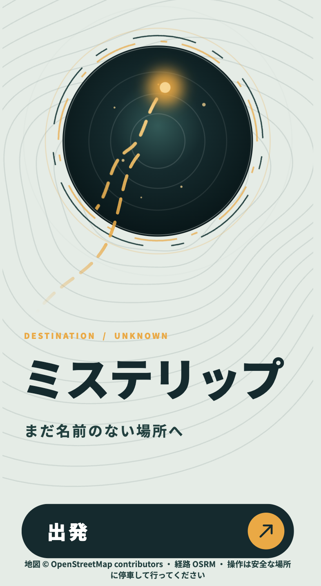

# MYSTERIP（ミステリップ）

「時間は決める。行き先は決めない。」



・デモ動画URL
https://vimeo.com/1236960116/3a6cd34344?share=copy&fl=sv&fe=ci

## 製品概要

### 背景(製品開発のきっかけ、課題等）

ツーリングやドライブでは目的地を先に決めることが多く、道中が予定どおりに移動するだけの時間になりがちです。行き先を知らずに出発することで、移動そのものを冒険に変えることを目指しました。

### 製品説明（具体的な製品の説明）

利用者が決めるのは片道の目安時間だけです。現在地から到達できる実在の目的地をサーバーが選び、行き先の名前を隠して道路経路・曲がる方向・音声で案内します。到着を確認すると目的地名とジャンルを表示します。現在の乗り物設定は自動車に固定されています。

### 特長

#### 1. 特長1：目的地を隠して出発

道の駅・自然・カフェ・歴史・温泉の中からジャンルと目的地を内部で選びます。通常の走行画面には目的地名を表示しません。

#### 2. 特長2：実際の道路経路で案内

OpenStreetMapで地点を探し、OSRMの道路経路を取得します。GPSの位置から次の案内地点と残り時間を計算し、「90m先右折」のように画面表示・音声で案内します。

#### 3. 特長3：選べる行き先の公開

到着時に目的地を公開します。途中で確かめたい場合も、走行画面から3回の確認を経て、取得済みの道路経路と目的地名を地図で見られます。操作は安全な場所に停車してから行ってください。

### 解決出来ること

行き先を決める負担を減らし、指定した時間を目安に知らなかった場所へ出かけるきっかけを作ります。

### 今後の展望

地域ごとの候補数・検索時間を測って目的地の発見率を改善し、実機でGPS・音声・道路走行を検証します。施設入口や立ち入り条件の確認、到着時に開封する物理的なチケットとの連携も検討しています。ハードウェア連携は未実装です。

### 注力したこと（こだわり等）

* 先にジャンルを選んでから候補を探し、施設数の多いジャンルだけに偏らないようにしています。候補への道路所要時間を確認し、指定時間の±15分から選びます。
* 目的地名と座標を通常画面へ直接渡さず、到着をサーバー側で判定します。

## 開発技術

### 活用した技術

#### API・データ

* OpenStreetMap、Overpass API、Nominatim：実在地点の検索。道の駅は[確認済みの手作業データ](data/roadside-stations.json)でも補います。
* OSRM Route API：自動車向けの道路距離・所要時間・経路形状・右左折情報。
* Geolocation API：ブラウザでの現在地取得。Web Speech API：日本語の音声案内。
* OpenFreeMap：経路地図のスタイル。

#### フレームワーク・ライブラリ・モジュール

* Next.js 16、React 19、TypeScript、Tailwind CSS。
* MapLibre GL JS：経路地図の表示。
* Vitest、ESLint：テストと静的チェック。

#### デバイス

* 位置情報を利用できるスマートフォンとブラウザ。スマートフォンからの接続にはHTTPSが必要です。
* 開発・展示用のPCブラウザ。専用ハードウェアは使用していません。

### 独自技術

#### ハッカソンで開発した独自機能・技術

* [ジャンルと目的地の選択](features/adventure/adventure-planner.ts)、[道路所要時間による判定](features/adventure/route-planner.ts)。
* [目的地の非表示](lib/seal.ts)と[到着判定](features/adventure/arrival.ts)。
* [経路上の進捗・曲がる方向](lib/navigation/engine.ts)と[音声案内](lib/speech.ts)。
* [3段階の地図確認](features/adventure/map-confirmation.ts)と[経路地図](components/adventure/route-map.tsx)。

## 環境構築

Node.js 24.xとnpmを使用します。

```sh
npm ci
npm run dev
```

http://localhost:3000 を開き、「出発」から画面を進めます。スマートフォンではHTTPS接続が必要です。

## 画面の流れ

| 画面 | URL | 内容 |
|---|---|---|
| 01 トップ | `/` | 「出発」で時間設定へ |
| 02 時間設定 | `/setup` | 円形ダイヤルで片道0〜120分（1分刻み）を選ぶ。0分では出発不可、1〜9分は10分として検索。ドラッグ・タップ・矢印キーで操作 |
| 03 検索中 | `/search` | 現在地を取得し、サーバーがジャンルと目的地を決める（レーダー表示。動きを減らす設定では静止） |
| 04 決定 | `/decided` | 所要時間のチップだけを表示。目的地・ジャンルは出さない |
| 05 走行中 | `/adventure` | 残り時間と次の曲がり角だけを表示。音声のON/OFF、中断 |
| 06 到着 | `/arrived` | 到着が確認できたときだけ名称を公開。ジャンルごとに背景を出し分ける。「もう一度」で時間は同じまま引き直す |

選ぶのは時間だけです。乗り物は自動車（OSRMの自動車プロファイル）に固定し、画面では選ばせません（`config/vehicle.ts`）。見た目は`components/screens/`にあり、デザインの正解（リポジトリ外のdesign-ref）のHTMLから座標・色・余白を変えずに移したものです。画面は390×844を基準に、スマートフォンでは背景をアドレスバーなどを除く実表示領域全体へ広げ、文字・ボタン・画像は縦横比を維持して中央に配置します。PC・タブレットでもデザインの縦横比を維持し、最大135%まで拡大します。

### ジャンルと目的地の決め方

ジャンルは**道の駅・自然・カフェ・歴史・温泉**の5つで、利用者には選ばせずアプリ内部で決めます（「絶景」の展望スポット・滝・山頂は「自然」に含めます）。先にジャンルを均等な確率で選び、そのジャンルの候補から目的地を選ぶため、候補数の多いジャンルに偏りません。候補が見つからないジャンルは次のジャンルを試します（公開APIへの負荷を抑えるため最大3ジャンル）。乱数は差し込めるようになっており、テストでは固定seedを使います。

OSMでは取れない道の駅は`data/roadside-stations.json`の手作業データで補います。現在は実座標を確認できた1件のみで、数十件への拡充は未了です。

### 目的地の非表示

目的地の名称・座標は、04・05の画面にも通信の応答にも含めません。応答には、サーバーだけが開ける非表示データ（`sealedDestination`）を入れ、到着の判定はサーバー（`POST /api/adventures/arrival`）が行い、到着が確定したときにだけ名称などを返します。`ADVENTURE_SEAL_SECRET`を設定すると封印の鍵を固定できます（未設定時はプロセスごとの乱数鍵で、サーバーの再起動後は開けません）。**ただし経路形状（geometry）の終端は目的地付近の座標になるため、通信を解析すれば行き先を推測できます。**厳密な秘匿にはサーバー側で案内を行う構成が必要です。


## 採用する技術構成

| 機能 | 技術 | APIキー |
|---|---|---|
| 地図データ | OpenStreetMap | 不要 |
| 道路経路 | OSRM（FOSSGIS公開自動車サービス） | 不要 |
| 観光地検索 | OpenStreetMap Overpass API と Nominatim | 不要 |
| GPS | Geolocation API | 不要 |
| 矢印 | 自作NavigationEngine | 不要 |
| 音声 | Web Speech API | 不要 |
| 到着判定 | 自作ArrivalDetector | 不要 |

OSRMはOSSです。公開サービスの継続提供や無制限利用を保証するものではありません。経路要求は同一サーバープロセス内で約1.1秒以上の間隔を取り、候補評価は最大5件です。

経路変換は[OSRM API仕様](https://project-osrm.org/docs/v5.7.0/api/)に基づきます。OpenStreetMapのデータを使うため、トップ画面の下部に帰属表示（© OpenStreetMap contributors）を置いています。

走行中の「行き先」から3回の確認を承諾すると、MapLibre GL JSとOpenFreeMapで取得済みの道路経路を表示します。確認文は「マップを表示しますか？」「本当にマップを表示しますか？」「本当にいいんですね？」の順です。途中でキャンセルすると地図を表示しません。再度開くと最初から確認します。地図は出発地点・道路経路・終点を表示し、最終確認後は目的地名も表示します。地図の地名や終点から行き先を推測できます。「ナビに戻る」またはEscapeで閉じます。切り替えで経路の再取得や目的地の再抽選は行わず、GPS・音声案内も継続します。地図にはWebGLと外部タイルへの通信が必要です。設定追加・APIキーは不要です。

## 観光地と経路データ

冒険作成APIは利用者の操作時に、ジャンルごとに現在地周辺の実在地点をOpenStreetMapから検索し、候補ごとにOSRMの道路経路を取得します。検索はジャンルで使い分けます。道の駅は名前検索が正確なNominatimを先に使います。それ以外はタグで種別を絞れるOverpass APIを先に使い、失敗または0件のときだけNominatimの自由語検索に進みます。Nominatimの結果は、種別（公園・カフェ・温泉・史跡・道の駅）がジャンルに合うものだけを使います。

| ジャンル | Overpassの検索条件（名前のあるもの） |
|---|---|
| 道の駅 | highway=services または rest_area で、名前に「道の駅」を含む |
| 自然 | 観光タグまたはWikidata登録のある公園、自然保護区、滝、展望地、山頂 |
| カフェ | amenity=cafe |
| 歴史 | 城、観光タグまたはWikidata登録のある史跡・遺跡・記念碑、観光タグまたはWikidata登録のある寺社 |
| 温泉 | 温泉の公衆浴場（bath:type=hot_spring または名前に「温泉」）、leisure=hot_spring |

個別の小さな碑や近所の公園を目的地にしないため、自然・歴史はタグで絞っています。公開サーバーは混雑や利用制限で応答しないことがあり、その場合は次の検索方法かエラー表示になります。固定の架空地点、直線、模式図へフォールバックしません。公開サービスが応答しない場合や実道路経路が見つからない場合は、エラーとして条件の変更・再試行を案内します。

所要時間は片道・渋滞非反映、指定時間の許容誤差は±15分、候補評価は最大5件です。現在地周辺の検索範囲はOverpassまたはNominatimへ、現在地と候補地点はOSRMへ送信されます。OpenStreetMap登録内容だけでは営業時間・駐車場入口・立入条件を保証できないため、到着後も現地の案内を優先してください。

## ナビと到着判定

OSRMが返す道路形状へGPS位置を投影し、経路上の進捗、次の案内、残距離、残時間を計算します。PCのWi-Fi測位も考慮し、ナビ案内には精度200m以内・測位60秒以内の位置情報を使用します。経路から大きく外れた場合は誤案内を避けるため案内と読み上げを停止し、安全な場所での停車を促します。自動再探索は未実装です。複雑な交差点では道路標識と現地状況を優先してください。

GPS精度50m以内、測位から15秒以内を有効とし、目的地50m以内の測位が1秒以上空けて2回連続すると到着を確定します。15秒を超える測位間隔は連続判定をリセットします。到着の判定はサーバーで行います。確定後はGPS監視と音声を停止し、名称を公開します。到着前の`/arrived`直接表示では目的地を公開しません。

走行中画面には残り時間と次の曲がり角だけを表示します。「行き先」ボタンは3段階の確認後に経路地図を開きます。停車してから操作してください。

音声は初期ONです（非対応のブラウザでは自動的にOFF）。04の「出発」をタップした瞬間に「案内を開始します」と話します。これはiPhoneのSafariなどが、画面操作の中で一度発話しないと、その後のGPS更新のタイミングでの発話を無音にするためです（Chromeも操作の直後でないと無音になることがあります）。発話に失敗した案内は読み上げ済みにせず、次の更新で最大3回まで読み直します。「音声」ボタンをONにした操作では、今の案内をもう一度読みます。分岐やロータリーなど向きを決められない案内は「進路に注意してください」と読みます。画面の案内（次の曲がり角）が切り替わるたびに、「140メートル先、右折です」「100メートル直進です」の形で日本語を読み上げます。その後、曲がり角の手前でも読み上げます（早めの予告と「まもなく、右折です」）。この距離は固定ではなく、検索で決まった経路の想定速度（曲がり角へ向かう区間の距離÷所要時間）から、曲がり角の約20秒前と約6秒前になるよう求めます。例えば市街地（約40km/h）では約220m前と約70m前、高速道路（約100km/h）では約560m前と約170m前です。極端な速度は範囲（早めの予告150〜800m、まもなく40〜250m）に収め、速度が分からないときは300m・80mを使います。実際のGPS速度は使っていないため、渋滞や停止中の速度変化は反映されません。同じ案内の距離が変わるだけでは繰り返しません。設定値は`config/navigation.ts`にあります。端末の音声エンジンに依存し、ブラウザによっては画面を操作した後でないと音が出ないことがあります（走行中画面の「音声」ボタンでON/OFFできます）。中断・エラー・到着・画面移動時にGPS監視または音声を停止します。到着公開は誤判定を避けるため従来どおり精度50m以内・測位15秒以内の位置情報を2回確認します。ブラウザを閉じた状態、バックグラウンドでの安定した動作、写真の自動取得は未対応です。経路はメモリにのみ保持し、再読み込みで破棄します。

公開OSRMでは専用のオートバイプロファイルを使用できないため、二輪車固有の通行禁止、排気量区分、細かな規制は反映されません。二輪専用ナビではないため、必ず道路標識と現地規制を優先してください。

スマートフォン実機でのGPS・音声と実道路走行は未検証です。画面は390×844でデザインのPNGと目視・画素差分で照合しました。自動テストは合成応答と位置サンプルで検証します。

## 環境変数

標準構成では.envの設定もAPIキーも不要です。.env.exampleは任意設定・旧実装用の変数名だけを記載しています。

| 名前 | 用途 |
|---|---|
| NEXT_PUBLIC_APP_URL | 将来の公開URL用。現在未使用 |
| OSM_NOMINATIM_URL | 任意のNominatim検索接続先。未指定時はOSMF公開HTTPSエンドポイントを使用 |
| OSM_OVERPASS_URL | 任意の予備Overpass API接続先。未指定時は公開HTTPSエンドポイントを順に使用 |
| ADVENTURE_SEAL_SECRET | 目的地の封印鍵（サーバー専用）。複数インスタンス・再起動をまたぐ場合は必ず設定 |
| DEMO_PIN_GENRE / DEMO_PIN_DESTINATION_ID / DEMO_SEED / NEXT_PUBLIC_DEMO_ORIGIN | デモ用の固定（上記参照） |

旧Googleアダプターとデモ用フィクスチャは既存の単体テスト互換性のため残していますが、利用者向けの冒険作成API・画面からは呼びません。

### 地図での目的地確認と方向表示

「行き先」の最終確認を承諾すると、`POST /api/adventures/reveal`で選択済みの目的地名を取得し、地図の見出しに表示します。取得失敗時は再試行できます。この操作は到着判定と独立しており、到着・冒険達成扱いにはしません。通常の走行中画面では名前を表示しません。走行中の距離は「90m先右折」「90m先左折」など、次の進行方向を併記します。

### 目的地名の復号鍵

`ADVENTURE_SEAL_SECRET`はサーバー専用の十分に長いランダム値を`.env.local`またはデプロイ環境へ設定してください。API間・サーバー再起動前後で同じ値を使います。値はコミットしません。未設定時は同一プロセス内の共通鍵でAPIモジュール再読込に対応しますが、再起動や別インスタンスでは共有できません。設定変更後は開発サーバーを再起動し、冒険を作り直してください。以前の鍵で作成した冒険は復号できません。
